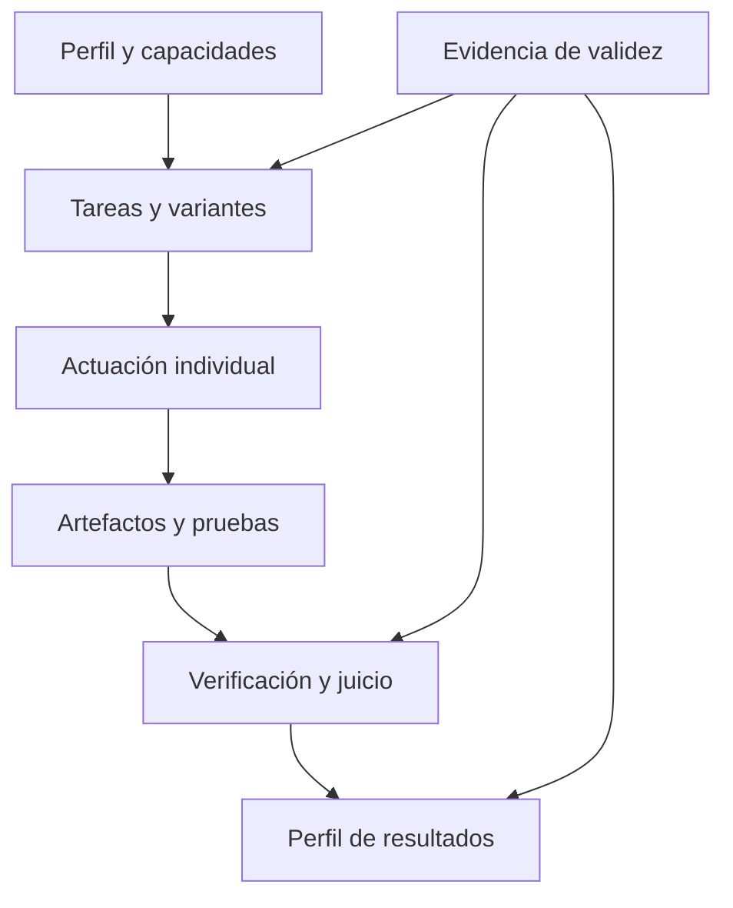

# Modelo de evidencia y validación

## Contrato conceptual propuesto

Los enlaces representan inferencias que deben justificarse. 

Respecto al uso de modelos matemáticos, el flujo no obliga a adoptar un modelo bayesiano ni a calcular una nota latente.

## Entidades que deben quedar trazadas

| Entidad                 | Campos esenciales propuestos                                         | Relación con lo existente                                           |
| ----------------------- | -------------------------------------------------------------------- | ------------------------------------------------------------------- |
| Definición de capacidad | ID estable, texto observable, alcance, versión y fuentes             | Trazabilidad de capacidades evaluadas; no sustituye D1–D4                   |
| Especificación de tarea | Capacidad, forma, condiciones, artefactos y criterios                | Extender manifiestos y fichas sin romper historial                  |
| Intento                 | Persona seudonimizada, versiones, modalidad, ayudas e incidencias    | Reutilizar `AttemptRecord`                                          |
| Revisión entregada      | Snapshot recuperable, hash, recibo y autoría                         | Comprobar qué persiste el adaptador actual                          |
| Resultado de prueba     | Entrada/fixture, revisión, salida, quién eligió ejecutarla y entorno | Ampliar donde falte procedencia; mantener separación alumno/docente |
| Juicio                  | Criterio, nivel, evidencia, evaluador y revisión                     | Reutilizar adjudicación, impedir cambios históricos silenciosos     |
| Decisión del perfil     | Regla versionada, cobertura, evidencia faltante e incertidumbre      | Incorporar solo tras definición y validación del uso                |

Este es un contrato de diseño, no un esquema de base de datos ya aprobado. Las decisiones sobre columnas, APIs y migraciones pertenecen a una implementación posterior.

## Administración

1. Familiarización con los controles de la interfaz y comprobación de acceso, con contenido ajeno al caso y sin instrucción sobre seguridad o soluciones.
2. Expediente y diagnóstico inicial con artefactos citados.
3. Intervención y pruebas; registro de revisiones y ayudas.
4. Entrega persistida con recibo; verificación independiente del snapshot.
5. Explicación y contraste según el constructo que se quiera observar.
6. Informe del desempeño y sus evidencias; conservación del historial de exposición para interpretar evaluaciones posteriores.

Pedir explicación durante la intervención puede cambiar la estrategia. Pedirla al final permite reconstrucción retrospectiva. Elegir el momento con una razón explícita y registrar qué evidencia representa cada respuesta.

## Política de puntuación para el primer instrumento

- Automatizar propiedades técnicas comprobables; reservar interpretación y alternativas para revisión humana.
- Conservar ejemplos de soluciones válidas diferentes y soluciones aparentemente correctas que fallan un contraste.
- Informar resultados según la ayuda efectivamente disponible.
- No atribuir automáticamente desconocimiento a fallo técnico, tarea no presentada o registro incompleto.
- Mantener el informe por dimensiones; cualquier combinación futura debe corresponder al perfil y uso validados.

## Diseño del piloto

Definir con la institución la población con formación previa, las competencias esperadas y el uso de los resultados: descripción del nivel demostrado, aprobación de una asignatura u otra decisión de evaluación. El primer piloto comprueba la comprensión de las tareas, la factibilidad de registrar evidencia y la calidad de la puntuación. El pilotaje valida el instrumento antes de utilizarlo para decisiones de aprobación o acreditación.

Seleccionar entregas para corrección independiente antes de conciliación. Examinar acuerdo por criterio con incertidumbre, dificultades de interpretación, variación por tarea y condiciones de ayuda. Elegir medidas de acuerdo según el tipo de puntuación y diseño; no usar un alfa global como prueba suficiente de validez.

Para comprobar si el resultado se sostiene en otras tareas, introducir variantes no expuestas y conservar el historial de acceso a soluciones. Si se pretende concluir que la capacidad se manifiesta fuera de CyberSim, incorporar una tarea externa pertinente. Estas comprobaciones amplían el alcance de la evaluación de capacidades ya adquiridas. También debe revisarse si la interfaz introduce dificultades ajenas a esas capacidades.

## Datos mínimos de investigación

Conservar IDs, versiones, decisiones, artefactos y resultados que respondan a afirmaciones definidas. Evitar capturar pulsaciones o biometría sin una hipótesis y necesidad justificadas. Acordar consentimiento, responsables y retención antes de participantes reales; esto no impide construir el prototipo.

Fuentes de la síntesis: [[NICE-by-design - Diseño trazable de escenarios]], [[REWIRE - Cursos y certificación por perfil]], [[Švábenský - Minería de actuaciones]], [[CTF - Límites de la puntuación competitiva]]. Las decisiones concretas del contrato son propuestas propias.

## Protocolo de pilotaje programable

| Fase | Datos y comparación | Decisión que habilita | Criterio de salida |
| --- | --- | --- | --- |
| Revisión de contenido | Panel de software/seguridad y evaluación contrasta blueprint con tareas | Publicar versión piloto | Cada afirmación tiene evidencia obtenible y al menos un contraste contra falso éxito |
| Entrevistas cognitivas | Observación voluntaria y retrospectiva sobre comprensión y uso de artefactos | Revisar consigna/UI/rúbrica | Problemas identificados resueltos o documentados, sin confundir este estudio con examen no intervenido |
| Pilotaje técnico | Entregas correctas, alternativas, engañosas e incidentes inyectados | Confiar en hechos automáticos delimitados | Recibos/snapshots reconstruibles; batería y procedencia correctas; fallos de infraestructura identificados |
| Pilotaje de puntuación | Correctores independientes antes de conciliación y tareas variadas | Revisar anclajes y preparación de los evaluadores | Informar acuerdo e incertidumbre por criterio, causas de desacuerdo y cambios; no fijar kappa mágico |
| Generalización/transferencia | Variante pertinente no expuesta y tarea externa cuando el uso lo requiera | Ampliar alcance de la afirmación | Estimar variación por persona/tarea/evaluador con diseño identificable; reconocer datos insuficientes |
| Estándar y consecuencias | Panel, trabajos ancla, casos frontera y sensibilidad | Decisión de nivel del perfil | Regla documentada, evidencia suficiente, revisión y seguimiento de decisiones |

El tamaño de muestra se planifica según precisión buscada y diseño, no copiando el N de otro paper. Un piloto pequeño sirve para detectar problemas de comprensión; no estima de forma estable todos los parámetros de un modelo multidimensional. Las pruebas técnicas verifican el software del instrumento; las observaciones de desempeño permiten comprobar la interpretación de sus resultados.

## Trazabilidad mínima de un test

Guardar `attemptId`, versión de tarea/fixture/verificador, revisión del artefacto, ID de prueba, entrada seleccionada o referencia reproducible, resultado, origen y actor, marca temporal y entorno. Separar `selected-by-student`, `automatic-feedback` y `teacher-battery` semánticamente; los nombres exactos del esquema se resolverán al implementar. Añadir estado de infraestructura y una razón interpretativa cuando corresponda.

No registrar que el alumno “verificó el aislamiento de R03” solo porque el corrector lo probó automáticamente. No registrar autonomía si la política de ayudas o exposición está incompleta. Una entrega con solo un hash requiere otro almacén que permita recuperar el artefacto; el hash por sí mismo no lo contiene.

## Fundamento ya disponible y revisión que sigue siendo necesaria

La definición del contenido no se deja abierta al piloto: [[Fundamento de las competencias de seguridad de CyberSim]] y [[Plan de cobertura del perfil]] identifican fuentes, capacidades, criterios técnicos y contraejemplos. El piloto examina la calidad del instrumento construido con esa base. No tiene como objetivo enseñar seguridad ni demostrar una mejora de aprendizaje.

La guía de corrección puede elaborarse y contrastarse con docentes de las asignaturas y entregas de muestra, sin convocar un comité para crear competencias nuevas. Los criterios automáticos deben especificar la revisión comprobada y el resultado esperado; el juicio humano debe citar la evidencia y aceptar alternativas correctas. Un uso de aprobación global exige además un estándar de desempeño justificable; un reporte descriptivo por capacidades puede mantener sus límites sin afirmar certificación profesional.

## Aplicación de los criterios

[[Guía para evaluar las competencias de seguridad]] operacionaliza los estados de evidencia y distingue pruebas propias, comprobaciones docentes y condiciones de ayuda. Antes del piloto se prepara una copia reproducible de cada tarea y una guía de juicio con soluciones válidas y falsos arreglos. Los criterios técnicos fundamentan el juicio de la entrega; su consistencia y el alcance de una conclusión se estudian mediante el instrumento.
